## 1. Instalación y acceso a Odoo

Una vez iniciado el despliegue, accedí a Odoo desde el navegador mediante http://localhost:8069.

Al entrar, utilicé el gestor de bases de datos para crear dos bases de datos:

- **demo:** con datos de demostración.
- **real:** sin datos de demostración.

En ambas seleccioné el idioma español y el país España.

Después de crearlas, entré en la base de datos `demo` e inicié sesión con el usuario administrador que había configurado.

Una vez dentro de Odoo, ya pude comenzar a realizar los ejercicios de la práctica.
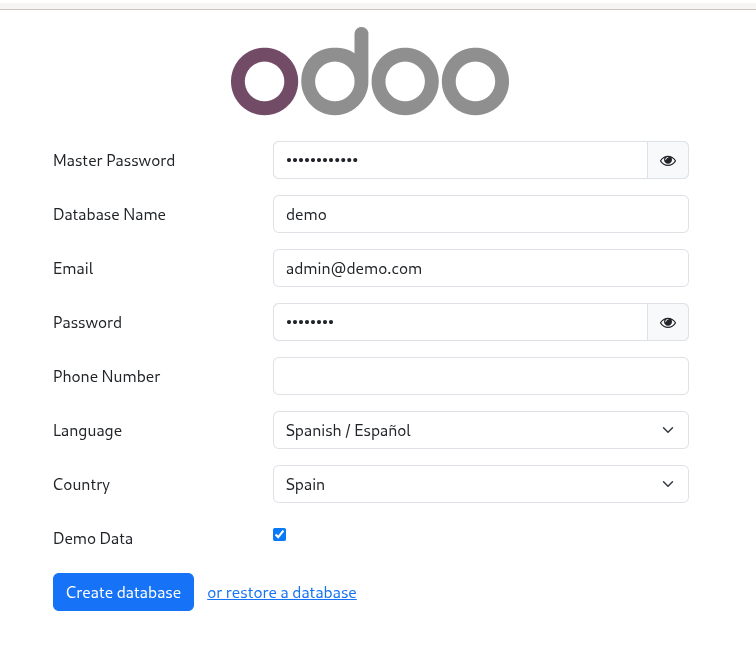
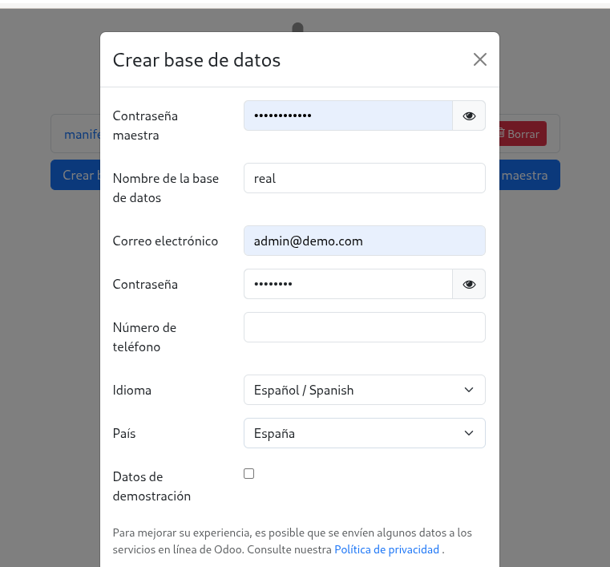
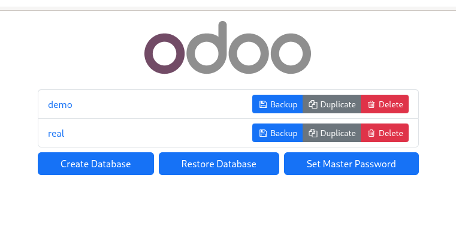

## 2. Pantalla de aplicaciones

En este apartado revisé las aplicaciones disponibles en Odoo y comprobé que tenía instaladas las necesarias para realizar la práctica: Contactos, Ventas, Facturación e Inventario.

Desde el apartado Aplicaciones también se pueden instalar nuevos módulos y ampliar las funciones de Odoo.

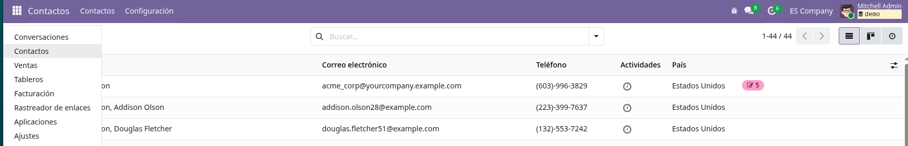

## 3. Productos e impuestos

Entré en Ventas → Productos y estuve mirando varios productos de la base de datos demo. Comprobé los diferentes tipos que hay en Odoo (bienes con inventario, bienes sin inventario, servicios y combinaciones).

También me fijé en sus precios, costes, impuestos y en las opciones de inventario para ver las diferencias entre ellos.

### Capturas de los productos revisados
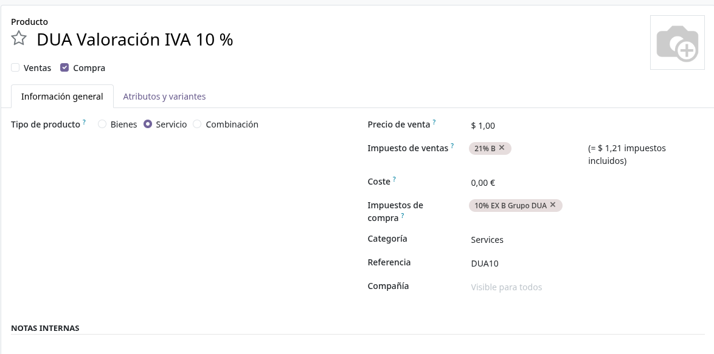
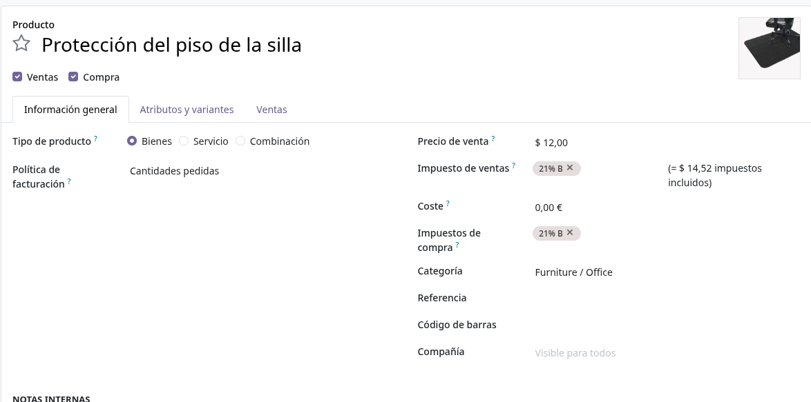
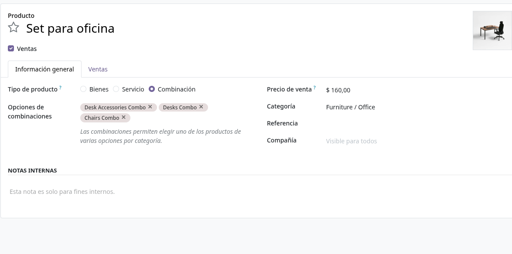

## 4. Recorrido del cliente a la factura pagada

En este ejercicio hice todo el proceso desde la creación del cliente hasta el registro del pago de una factura. También revisé una factura de proveedor y programé una llamada para el cliente.

### 1. Contactos

Primero estuve mirando un contacto de empresa y otro de persona para ver las diferencias entre ambos y cómo se pueden relacionar.

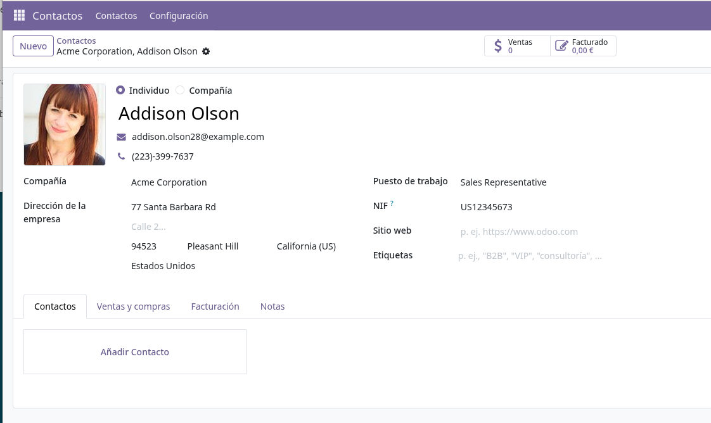

### 2. Crear un cliente

Después creé un nuevo cliente llamado Empresa Prueba DAM, añadiendo su CIF, dirección y la etiqueta correspondiente.

### 3. Crear productos

Creé dos productos para utilizarlos en la venta: un servicio llamado Hora de soporte por 40 € con un IVA del 21 % y un bien llamado Libro técnico por 25 € con un IVA del 4 %. En los dos marqué la opción de Ventas.

### 4. Presupuesto y pedido de venta

A continuación, preparé un presupuesto para el cliente con los dos productos. Lo envié desde Odoo sin mandar ningún correo real y después lo confirmé para convertirlo en un pedido de venta.

### 5. Crear y pagar la factura

Desde el pedido de venta creé la factura y comprobé que cada producto tenía su IVA correspondiente y que el importe total era correcto. Después la confirmé, imprimí el PDF y registré el pago hasta que apareció el estado Pagado.

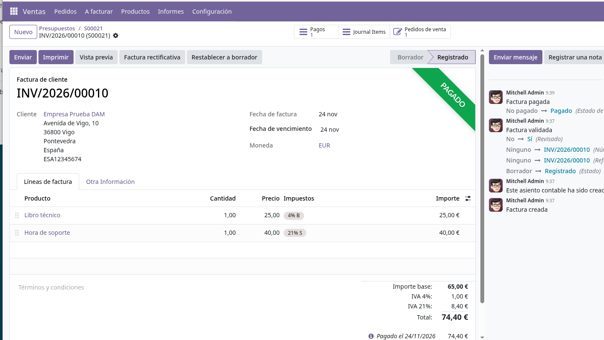

### 6. Factura de proveedor

Busqué una factura de proveedor de los datos de demostración y la comparé con la factura de cliente que había creado anteriormente.

Las dos tienen datos como la fecha, las líneas de productos, los impuestos y el importe total. La diferencia es que la factura de cliente corresponde a una venta que realiza nuestra empresa, mientras que la de proveedor corresponde a una compra que realiza nuestra empresa.

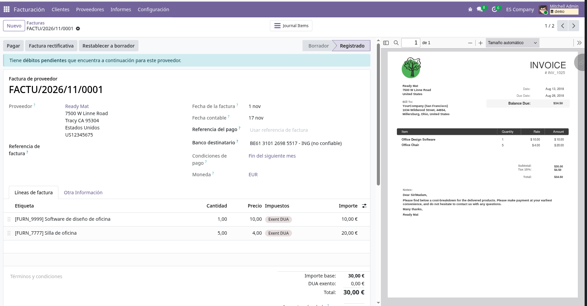

### 7. Programar una llamada

Por último, desde el historial de actividades del cliente (Chatter), programé una llamada para dejar registrada una actividad pendiente.
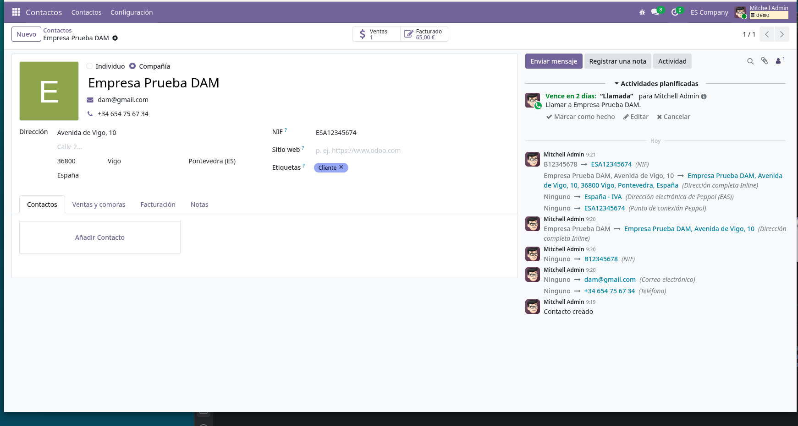

## 5.Vistas, búsquedas y filtros

En este ejercicio estuve probando las diferentes formas de ver y organizar la información en Odoo, como la vista de tarjetas, la vista de lista y los filtros.

Después, en Facturación → Clientes → Facturas, apliqué el filtro para mostrar las facturas publicadas, las agrupé por cliente y guardé la búsqueda en favoritos para poder utilizarla más adelante.

## 6. Modo desarrollador

En este apartado activé el modo desarrollador de Odoo para poder consultar información técnica que normalmente no aparece.

Primero lo activé añadiendo `?debug=1` a la dirección de Odoo. Después comprobé que estaba activo porque apareció el icono del escarabajo en la barra superior.

También revisé dónde se puede activar desde Ajustes y consulté los nombres técnicos de algunos campos del formulario de contactos y el modelo de las facturas.

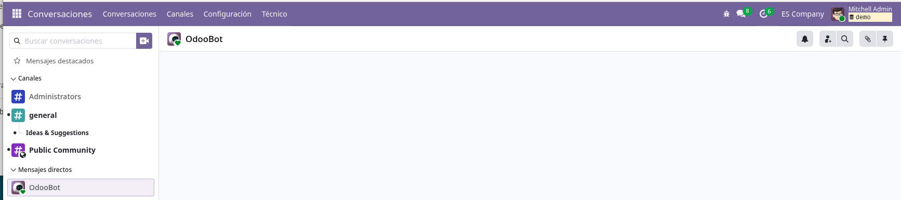

## 7. Tabla incidencias

Durante la práctica me surgieron algunas dudas al utilizar Odoo, sobre todo al buscar ciertas opciones y consultar la información técnica.

| Fecha | Síntoma | Causa | Solución aplicada |
|-------|---------|-------|------------------|
| 24/11/2026 | No encontraba algunas opciones del modo desarrollador. | No tenía claro dónde estaban situadas dentro de Odoo. | Consulté las opciones desde el icono del escarabajo y el menú de Ajustes. |

## 8. Declaracón uso de IA

Para realizar esta práctica utilicé ChatGPT como ayuda para resolver dudas sobre Odoo, seguir los pasos de los ejercicios y preparar el README.

También utilicé sus respuestas como orientación, comprobando los pasos dentro de mi propia instalación de Odoo y adaptando los textos para que coincidieran con lo que realmente había realizado.